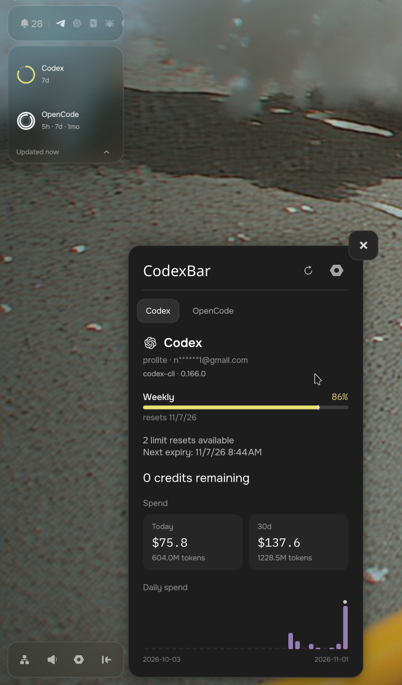

# CodexBar for Plasma and Pond

AI provider usage, limits, credits and local spend on your desktop. Use the
Plasma 6 widget or the Pond Quickshell sidebar. Both use the
[CodexBar CLI](https://github.com/steipete/CodexBar) and a bundled Linux helper
to fetch provider data.

## Screenshots

### Plasma 6


### Pond



## What it shows

- Remaining usage and reset times for each provider and account. Pace markers
  compare remaining usage with the time left in the limit window.
- Credit balances, available limit resets and provider status, when reported.
- Today's spend, 30-day totals and daily history with per-model details.
  Local cost estimates are separate from billed charges and usage limits.
- OpenCode's 5-hour, weekly and monthly subscription limits.
- The last successful reading when a temporary failure prevents an update.

Both desktops support the active account, all accounts or selected accounts.
You can also add profiles for separate API keys or sources. Account support
depends on the provider. Antigravity can read several saved browser logins
without switching the active login.

| Desktop | Controls |
| --- | --- |
| Plasma 6 | Panel icons or usage bars, a provider dashboard, provider selection, tray colors and cross-device sync. |
| Pond | Sidebar rows, compact tiles or a collapsed rail, separate or nested rings, provider pages and Pond settings. |

Pond can place several limit windows in nested rings, with the shortest window
outside. Set ring size, width and gap, and choose which icons and labels to
show. Tooltips and keyboard focus retain the usage details when labels are
hidden. If all windows do not fit, an exhausted window takes priority.

Appearance settings can apply to all providers or one provider. Each provider
can override ring layout, size, labels and pace markers. Unchanged settings
use the shared defaults. Use **Use defaults for this provider** to remove its
overrides. These settings apply to all accounts of that provider.

Ring colors can use automatic warnings, the provider color, remaining usage,
usage pace or the Pond text color. You can set a custom provider color with a
`#RRGGBB` value. Provider-colored pace markers use that color too.

Pond also has per-provider refresh intervals, retry attempts and failure
cooldowns. Cross-device sync setup and selecting several providers in one
dashboard are currently available only in Plasma.

## Install

Clone the repository:

```sh
git clone https://github.com/slopfire/codexbar-plasmoid-pond.git
cd codexbar-plasmoid-pond
```

Both integrations need Node.js on `PATH`. Source installs also need Cargo to
build the Linux helper. Install the upstream CodexBar CLI, or enable managed
CLI updates in settings. The Linux helper supplies native provider access and
local cost scans; some providers still need the upstream CLI.

### Plasma 6

Install KDE Plasma 6 and `kpackagetool6`, then run:

```sh
./scripts/install-plasmoid.sh
```

Add **CodexBar** from the Plasma widget explorer under System Information.
Rerun the install command after pulling updates.

You can also install a packaged release from
[GitHub releases](https://github.com/slopfire/codexbar-plasmoid-pond/releases)
or [KDE Store](https://store.kde.org/p/2365275):

```sh
kpackagetool6 --type Plasma/Applet --install codexbar-plasmoid-v0.1.12-plasma6.plasmoid
# To replace an installed version:
kpackagetool6 --type Plasma/Applet --upgrade codexbar-plasmoid-v0.1.12-plasma6.plasmoid
```

The package ID is `org.slopfire.codexbar-plasmoid`. Packaged releases include
an x86_64 Linux helper. On other architectures, build from source.

### Pond and Quickshell

Install Pond, Quickshell, Python 3, Node.js and Cargo, then run:

```sh
./scripts/install-quickshell.sh
codexbar-pond settings
```

The installer adds the module to `~/.config/quickshell/pond-shell` and the
command to `~/.local/bin`. Add that directory to `PATH` if needed. It validates
Pond's hooks, backs up changed files and preserves settings. A running Pond
shell reloads the files.

```sh
codexbar-pond toggle      # open or close the dashboard
codexbar-pond refresh     # refresh usage
codexbar-pond start       # start Pond if it is not running
codexbar-pond doctor      # check the installation
```

For another Pond location, pass `--pond-dir /path/to/pond-shell` to the
installer. Add `--dry-run` to inspect the planned changes. Rerun the installer
after pulling updates.

See the [Pond guide](quickshell/README.md) for settings, shortcuts, previews
and backup restore commands.

## Configure providers and accounts

Open the widget settings in Plasma, or run `codexbar-pond settings`.

In **Providers**, enable the providers you use and choose each source. Auto
selects a source for the provider and platform. You can select CLI, API,
OAuth, web or native access where the provider supports it. Some web sources
require macOS.

For each provider, choose the active account, all accounts or selected
accounts. Detect accounts, then check the names to show. You can also enter a
name or email. Unchecking an account hides it without deleting its saved
login. A failed selected account stays visible beside accounts that work.

Use **Add another account profile** for a separate key or source. New profiles
start with an empty key. OAuth sources may return only the active login; the
widget reports a mismatch if you select a different name. Antigravity's
sign-out control removes one selected saved login after confirmation.

In **General**, set the CLI path, refresh interval, timeout, cost scans and
email masking. Email addresses are masked by default. Local spend is scanned
in the background, so a large history does not block the dashboard. The next
refresh shows the new totals. Incomplete history has a note on the card.

Temporary failures keep the last successful reading and trigger bounded
retries. Failure cooldowns start at 30 seconds and increase to the configured
cap, which defaults to 180 seconds. Matching widget requests share cached
readings. Manual refresh bypasses older cached usage. Pond's Providers page
can override the general refresh interval, retry attempts and cooldown for
each provider.

In **Appearance**, adjust the desktop's bars or rings, pace markers, labels
and history chart. Bars and rings show the percentage remaining. Their pace
marker shows how much time remains in the window. When several accounts
share provider-wide costs, those totals appear once with provider labels.

Plasma's **Sync Write** and **Sync Read** copy provider settings between local
widget instances only when pressed. This includes API keys. Colors, tray
choices and selected dashboard providers stay local to each widget.

Pond stores settings in `~/.config/codexbar-plasmoid/config.json`, or under
`$XDG_CONFIG_HOME`. The file permits only its owner to read or write it. The
helper receives provider settings through standard input, so keys do not
appear in process arguments.

### Managed CLI updates

Enable **Auto-download from GitHub** in Plasma or **Update managed CLI** in
Pond. The updater installs the upstream CLI at:

```text
~/.local/share/codexbar-plasmoid/bin/codexbar
```

It checks for releases at most once a day, verifies the archive's SHA-256
checksum and tests the binary before replacing the installed copy. A failed
update keeps the previous copy. Linux updates prefer musl builds and fall
back to glibc builds when no musl asset exists. That fallback may need extra
runtime libraries or `nix-ld` on NixOS.

Keep the CLI path set to `codexbar` to use the managed copy, or set an absolute
path for your own CLI installation.

### API keys and the session environment

Enter API keys in provider settings. The helper can also read keys from
`~/.codexbar/config.json`:

```json
{
  "providers": {
    "openai": { "apiKey": "<key>" },
    "openrouter": { "apiKey": "<key>" }
  }
}
```

The helper maps keys to the provider's environment variables. An existing
environment variable takes priority. Inline provider settings take priority
over the shared config file.

Desktop processes may not inherit exports from your shell startup files. The
helper also reads `$XDG_CONFIG_HOME/environment.d/*.conf`, which defaults to
`~/.config/environment.d/*.conf`, then `~/.codexbar/.env`. Existing process
variables win over both files. Use these files for keys and paths that the
desktop needs, including NixOS runtime paths.

### Linux helper

The bundled `codexbar-plasmoid` binary handles Linux access for Antigravity,
CodeBuddy, Command Code, Cursor, Devin, Grok, OpenCode and OpenCode Go. It can
read existing local sign-ins or browser cookies where supported. Encrypted
Chromium cookie import requires `secret-tool`.

Antigravity can use a running IDE or saved browser OAuth accounts. To sign in
without the IDE running:

```sh
plasmoid/contents/code/codexbar-plasmoid login --provider antigravity
```

The login needs a local Antigravity `agy` installation to obtain the OAuth
client configuration. It stores tokens under `~/.config/antigravity-usage`.
In settings, choose Native Auth, or use Linux Helper to try the IDE first and
fall back to saved tokens.

Devin needs a bearer token and organization. CodeBuddy reads its local
sign-in, and Command Code reads `~/.commandcode/auth.json`. OpenCode and
OpenCode Go use a browser session for subscription limits and local databases
for token spend. Codex cost scans read local session logs. Local history does
not include activity whose logs are absent from this computer.

## Sync server

Plasma widgets can publish usage to a self-hosted server. Other Plasma
widgets and the Android app can read the merged data without provider
credentials. Pond does not yet have sync-server settings.

To build, install and start the user service:

```sh
./scripts/install-sync-server.sh
```

The service binds to `127.0.0.1:8188` by default. To run the installed binary
directly with a different bind address:

```sh
~/.local/share/codexbar-plasmoid/bin/codexbar-plasmoid sync-server --bind 0.0.0.0 --port 8188
```

The server generates a token when none is supplied. Read it locally with
`sync-server --show-token`. You can instead set `CODEXBAR_SYNC_TOKEN` or pass
`--token`. The server uses plain HTTP. Use a trusted LAN, a VPN or an HTTPS
reverse proxy to protect the token in transit.

In Plasma's General settings, enter the server URL and token. Successful
local refreshes then publish usage snapshots. Choose **Sync server** as a
provider source to read merged data. Enable **Sync all from the server** on
a device that should skip local provider access and cost scans.

The server takes the freshest successful limits for each provider and
account. It combines distinct daily histories, counts matching history
fingerprints once, and uses the freshest copy of cloud history. Credentials
stay on the publishing devices. Publications contain normalized usage data
with the widget's current email-masking setting. Snapshots expire after
60 days.

### Android client

The [Android app](android/README.md) reads the sync server. It shows provider
limits, credits, spend, daily model details and contributing devices. Its
home screen widgets show the tightest limit, a provider list or spend totals.
Each widget has its own provider selection and appearance settings.

```sh
cd android
./gradlew :app:assembleDebug
./gradlew :app:testDebugUnitTest
```

Set up the Android SDK as described in the Android guide before building.

## Development and checks

Run from the repository root:

```sh
./scripts/agent-check.sh
./scripts/run-config-smoke.sh
./scripts/quickshell.sh check --ui
python3 -m unittest discover -s quickshell/tests
```

These checks use isolated KWin sessions for UI tests. They do not open host
desktop windows. For a Pond preview with synthetic data:

```sh
./scripts/quickshell.sh preview --virtual --output /tmp/codexbar-pond.png
```

Build a Plasma release archive:

```sh
./scripts/package-plasmoid.sh
```

The archive is written to
`dist/codexbar-plasmoid-v<version>-plasma6.plasmoid`. From a clean working
tree, `./scripts/package-plasmoid.sh --bump` also increments the patch version,
updates metadata and release notes, and creates a release commit. See the
[changelog](CHANGELOG.md) for released versions.

## License

[MIT](LICENSE). Provider icons retain their included license notices.
